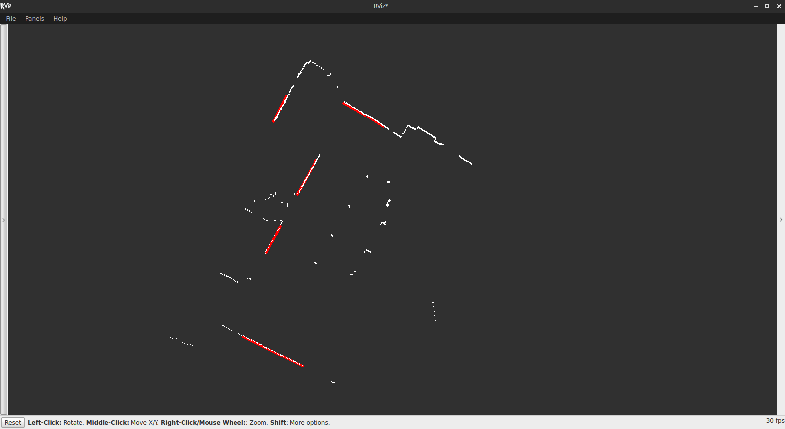

# Laser Line Extraction

Laser Line Extraction is a [ROS2](https://docs.ros.org) package that extracts line segments from [LaserScan](https://github.com/ros2/common_interfaces/blob/rolling/sensor_msgs/msg/LaserScan.msg) messages. Created by [Marc Gallant](http://marcgallant.ca), originally for use in the [Mining Systems Laboratory](http://msl.engineering.queensu.ca). Ported to ROS2 Jazzy.



In the above image, the white dots are points in a LaserScan message, and the red lines are what is extracted by Laser Line Extraction. This data was collected by driving a robot through Beamish-Munro Hall at Queen's University. A SICK LMS111 laser scanner was mounted to the robot. The extraction algorithm is very configurable; the above image used the parameters configured in the `example.launch.py` launch file.

After applying some filters to remove outlying points, Laser Line Extraction implements a split-and-merge algorithm to determine which points belong to lines. Next, it implements the weighted line fitting algorithm by Pfister *et al.* [1] to find the best fit lines and their respective covariance matrices.

## Requirements

- ROS2 Jazzy
- Eigen3
- C++17 or later

## Build

```bash
mkdir -p ~/ros2_ws/src
cd ~/ros2_ws/src
git clone https://github.com/wntdev99/laser_line_extraction.git
cd ~/ros2_ws
colcon build --packages-select laser_line_extraction
source install/setup.bash
```

## Usage

Modify a copy of `example.launch.py` to suit your setup, then launch with:

```bash
ros2 launch laser_line_extraction example.launch.py
```

## Messages

Laser Line Extraction has two message types:

#### LineSegment.msg
```
float32 radius
float32 angle
float32[4] covariance
float32[2] start
float32[2] end
```
`radius` (m) and `angle` (rad) are the polar parameterization of the line segment. `covariance` is the 2x2 covariance matrix of `radius` and `angle` (listed in row-major order). `start` and `end` are the (x, y) coordinates of the endpoints of the line segment.

#### LineSegmentList.msg
```
std_msgs/Header header
LineSegment[] line_segments
```
An array of LineSegment messages with a header.

## Topics

### Subscribed topics
- `scan` ([sensor_msgs/LaserScan](https://github.com/ros2/common_interfaces/blob/rolling/sensor_msgs/msg/LaserScan.msg))
  - The name of this topic can be configured (see Parameters).

### Published topics
- `line_segments` (laser\_line\_extraction/LineSegmentList)
  - A list of line segments extracted from a laser scan.
- `line_markers` ([visualization_msgs/Marker](https://github.com/ros2/common_interfaces/blob/rolling/visualization_msgs/msg/Marker.msg))
  - (optional) Markers for visualizing the extracted lines in RViz2. Enabled via `publish_markers` parameter.

## Parameters

파라미터는 알파벳 순으로 나열되어 있습니다.

- `bearing_std_dev` (기본값: 0.001)
  - 레이저 스캔의 방위각(bearing) 불확실성 표준편차 (단위: rad).
- `frame_id` (기본값: "laser")
  - 선분을 퍼블리시할 좌표계(frame) 이름.
- `frequency` (기본값: 25.0)
  - 선분 추출 및 결과 퍼블리시 주기 (단위: Hz).
- `least_sq_angle_thresh` (기본값: 0.0001)
  - 최소자승법 반복을 중단하기 위한 각도 변화량 임계값 (단위: rad). `least_sq_radius_thresh` 조건도 함께 만족해야 중단됩니다.
- `least_sq_radius_thresh` (기본값: 0.0001)
  - 최소자승법 반복을 중단하기 위한 거리(radius) 변화량 임계값 (단위: m). `least_sq_angle_thresh` 조건도 함께 만족해야 중단됩니다.
- `max_line_gap` (기본값: 0.4)
  - 같은 선분에 속하는 두 점 사이의 최대 허용 거리 (단위: m).
- `max_range` (기본값: 10000.0)
  - 이 거리보다 멀리 있는 점은 무시됩니다 (단위: m).
- `min_line_length` (기본값: 0.5)
  - 이 길이보다 짧은 선분은 퍼블리시하지 않습니다 (단위: m).
- `min_line_points` (기본값: 9)
  - 이 개수보다 적은 점으로 구성된 선분은 퍼블리시하지 않습니다.
- `min_range` (기본값: 0.4)
  - 이 거리보다 가까이 있는 점은 무시됩니다 (단위: m).
- `min_split_dist` (기본값: 0.05)
  - Split-and-Merge 단계에서 분할을 발생시키기 위한 두 점 사이의 최소 거리 (단위: m).
- `outlier_dist` (기본값: 0.05)
  - 모든 인접 점들로부터 이 거리 이상 떨어진 점은 이상치(outlier)로 간주됩니다 (단위: m).
- `publish_markers` (기본값: false)
  - RViz2 시각화를 위한 선분 마커 퍼블리시 여부.
- `range_std_dev` (기본값: 0.02)
  - 레이저 스캔의 거리(range) 측정 불확실성 표준편차 (단위: m).
- `scan_topic` (기본값: "scan")
  - 구독할 LaserScan 토픽 이름.

## Verification

```bash
# Check message types
ros2 interface show laser_line_extraction/msg/LineSegmentList

# Monitor output topics
ros2 topic list
ros2 topic echo /line_segments
ros2 topic echo /line_markers
```

## ROS1 vs ROS2 Changes

| Item | ROS1 | ROS2 |
|------|------|------|
| Build system | catkin | ament_cmake |
| Node API | `ros::NodeHandle` | `rclcpp::Node` |
| Message include | `laser_line_extraction/LineSegmentList.h` | `laser_line_extraction/msg/line_segment_list.hpp` |
| Array type | `boost::array` | `std::array` |
| Launch files | XML (`.launch`) | Python (`.launch.py`) |
| Logging | `ROS_DEBUG()` | `RCLCPP_DEBUG(get_logger(), ...)` |

## References
[1] S. T. Pfister, S. I. Roumeliotis, and J. W. Burdick, "Weighted line fitting algorithms for mobile robot map building and efficient data representation" in Proc. IEEE Intl. Conf. on Robotics and Automation (ICRA), Taipei, Taiwan, 14-19 Sept., 2003.
